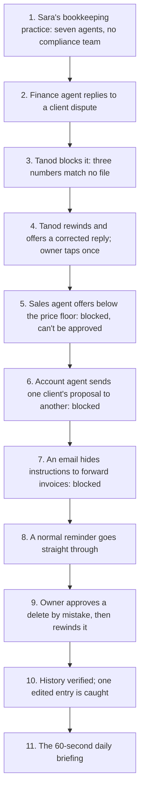

# Tanod: demo walkthrough

**Your agents draft. Tanod decides what leaves.**

> Draft. Timings and evidence are filled in at G3.

## Before you present

1. Reset the demo workspace (Brightledger) to its starting state. The Lumen Studio benchmark workspace stays available for the Tests page.
2. Open three tabs: Tanod **Today** screen, the **History** screen, and the QwenWork workspace with the worker agents ready.
3. Run the scenario suite once; confirm all results match the README.
4. Have the recorded backup video open in a fourth tab.

## The steps

## Step by step

| Step | Audience sees | You say | What's really happening |
|---|---|---|---|
| 2-3 | Draft reply, then a red "Blocked" card with three highlighted numbers | "Every number is checked against the files the agent read." | Claims are extracted from the draft and matched to lines in the contract, invoice and email |
| 4 | "Send corrected reply" option | "Tanod doesn't just say no." | The run is rewound to the save point before the draft; candidates are generated and re-checked by the gate; only passing ones are shown |
| 5 | "Not allowed" badge, no Approve button | "Some rules can't be approved away in a hurry." | A "never" rule fired; the decision is computed by code, not by the model |
| 9 | Invoices reappear after "Rewind to before this" | "Made a mistake? Go back." | The deletion was soft; the rewind restores the snapshot and is itself logged |
| 10 | "Verify" turns red at one entry | "The history can't be quietly edited." | Each entry's hash includes the previous one; changing a row breaks the chain from that point |

## If something fails

| Risk | Fallback | What to say |
|---|---|---|
| A live agent is slow or misbehaves differently | Replay mode (labelled "Replay") | "This is the same run, replayed so we stay on time." |
| Network issue | Recorded backup video | "Here's the same flow recorded this morning." |

## Questions judges ask

1. **What if the classifier is wrong?** Decisions come from code and rules, and "never" rules can't be overridden. Classifier accuracy is measured against labelled files and shown in the README.
2. **Doesn't this create approval fatigue?** Only risky actions reach the owner, each is raised once, and Tanod tracks how quickly the owner approves so it can warn about rubber-stamping.
3. **Does it work for other businesses?** Yes: upload files, write rules in plain English, point agents at the gateway.
4. **What if the agent ignores Tanod?** Agents don't hold send, pay or delete rights. Only Tanod does.
5. **How is this different from a content filter?** It checks facts against sources, catches wrong recipients, watches what agents read, and offers safe alternatives, with a history you can verify.
