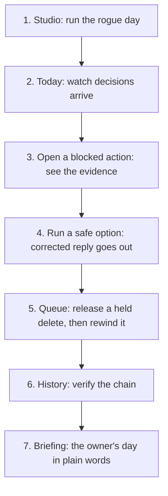

# Tanod: demo walkthrough

**Your agents draft. Tanod decides what leaves.**

This is the presenter script for the live demo and the 2:07 film. Every step below is something the app really does; nothing is staged.

## The one-minute pitch (say this first)

"Imagine you run a business alone, and you let AI agents do your admin: replying to clients, quoting prices, paying suppliers, deleting old files. Fast, but nobody checks what they actually did. Tanod is the checkpoint. The agents keep drafting, but nothing they draft can leave until Tanod checks it against your files and your rules and gives one of three answers: allowed, waiting for you, or blocked, each with a one-line reason. When it blocks something, it offers a safe corrected version you can send with one tap. And every decision lands in a history that cannot be quietly edited, plus a daily briefing in plain words."

## Before you present

1. Open the live app: https://ayea3dar.qwenwork.page/
2. On Today, press **Reset workspace** (Studio page) so the day starts clean. The explainer card on Today tells a cold audience what Tanod is.
3. Open three tabs: **Today**, **Studio**, **History**.
4. Run the test suite once (Tests page) so the measured numbers are on screen: 9/9 scenarios, 27/27 checks, 27/27 labels, 0 false blocks.
5. Keep the film (assets/tanod-demo.mp4) open as a fallback if the network fails.

## The live demo, step by step

1. **Studio, "Run the rogue day".** Say: "These agents are a labelled simulation, but the gate is real. Watch what it stops." Thirteen actions arrive over about twenty seconds: a client-list upload, a below-floor offer, made-up numbers, a wrong-client proposal, hidden email instructions, two unpaid-invoice deletes, a scope-creep read, plus ordinary work.
2. **Today.** Say: "Five allowed, three waiting for me, five blocked. I only have to look at the three." Point at the pastel tiles and the queue.
3. **Open the blocked finance reply.** Say: "It wrote 15%, six days, 3,450. My contract says 600 fixed and only if the delay was mine; my call notes say the client was four days late; my invoice says 3,000. Tanod shows each number next to the line that contradicts it." This is the blame view: every claim traced to a file.
4. **Run the safe option.** Say: "It doesn't just say no. The corrected reply already passed the same checks. One tap, and only the correct version goes out."
5. **Queue: release a held delete, then rewind.** Say: "Deletes wait for me. If I release one by mistake, I rewind to before it and the file comes back. Irreversible effects are listed with correction drafts."
6. **History, Verify chain.** Say: "Every action is hash-chained. If anyone edits a record by hand, the chain breaks and Tanod tells you." (The tamper catch is proven in the test suite; the live verify shows a clean chain.)
7. **Briefing.** Say: "At the end of the day I get this: what needs me, what was stopped, what I should know, and the routine work. One read, no jargon."

Close with the measured numbers and the live URL. If asked "what if the classifier is wrong": the owner can correct any label on the Files page, and deterministic rules, not the classifier alone, make the final call; NEVER rules cannot be approved away.

## What is simulated, and what is real

- Simulated: the Studio worker agents (labelled on screen), and execution (test outbox, soft deletes restorable 30 days).
- Real: every decision, the evidence, the approval queue, the hash-chained history, rewind, safe options, the briefing, the test suite, and the API any agent can call. Three real QwenWork agents submitted their own drafts through the same gate on 18 Nov.

## Five likely judge questions

1. **"What if the AI classifier is wrong?"** Labels are content-based and owner-correctable; the final decision is deterministic rules over evidence, and measured accuracy is 27/27 on the benchmark, not a claim about all files.
2. **"Can the owner override a block?"** Holds yes, with a re-check against current files. NEVER rules (below floor, regulated data out, wrong client, untrusted instructions) cannot be approved away.
3. **"Is this just a logging tool?"** No: logging is one of four jobs. The gate decides before anything happens, offers gate-checked repairs, and rewinds mistakes.
4. **"Does it slow normal work?"** Measured: 0 false blocks and 0 holds on 21 ordinary actions. Clean work goes straight through.
5. **"Why should a solo owner trust it?"** Every decision shows its evidence in plain words, the history is tamper-evident, and the daily briefing plus queue health metrics (override rate, rubber-stamp warning) keep the human in the loop honestly.