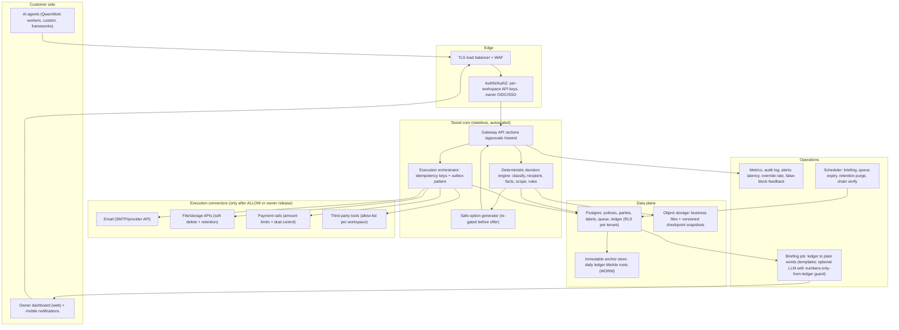
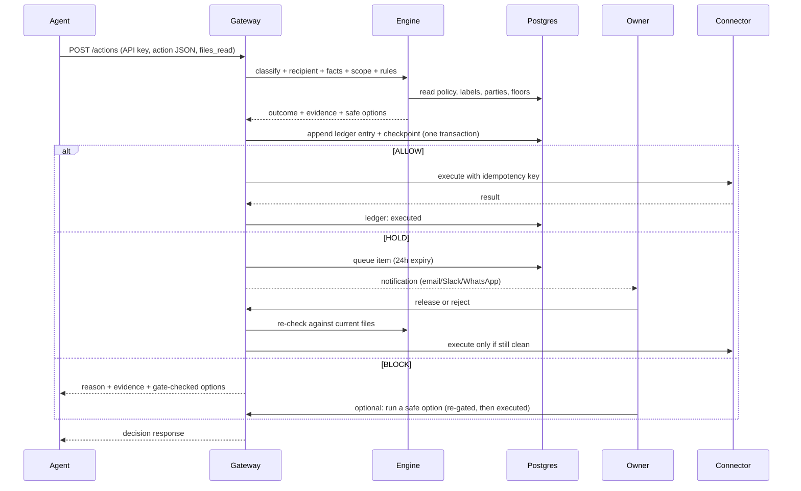

# Tanod in production: infrastructure and technical feasibility

This document describes how Tanod runs in production: the infrastructure, the request lifecycle, the security and reliability model, and the evidence that the design is feasible. It separates three things honestly:

- **Running today** (the hackathon build, live at https://ayea3dar.qwenwork.page/).
- **Production design** (the proposed target architecture; not yet deployed).
- **Measured evidence** (numbers produced by the built-in runner and local benchmarks on 18 Nov 2026).

Anything labelled *estimate* is a planning assumption, not a measurement or a quote.

---

## 1. What runs today

| Component | Today (hackathon build) |
|---|---|
| Gateway + decision engine | One Node.js service, zero runtime dependencies, on QwenWork Pages |
| Storage | Provisioned Supabase-compatible Postgres (12 tables) |
| Files | Stored as rows with content; labelled at ingest by the content classifier |
| Execution | Simulated: test outbox, soft deletes restorable 30 days |
| Agents | Studio simulation (labelled) plus three real QwenWork agents that called the API |
| Briefing | Template-generated page + two QwenWork scheduled tasks |
| Auth | None (single-tenant demo); workspace id in the URL |

The engine, the API contract, the ledger, the queue, rewind and safe options are production-shaped already: they are the same code paths a production deployment would run. What production adds is real execution connectors, authentication, multi-tenant isolation, and operational hardening.

## 2. Production architecture (proposed)

Design decisions that matter:

1. **The decision path contains no LLM.** Classification, checks and rule evaluation are deterministic code. That makes decisions reproducible, explainable, fast and cheap, and it means a model outage cannot take the gate down. An LLM is optional and confined to briefing prose, with a hard guard: every number in a briefing must come from the ledger, and templates are the fallback.
2. **Agents hold no credentials for the outside world.** Execution connectors live behind the gate and receive a payload only after an ALLOW decision or an owner release. An agent that is compromised or prompt-injected can draft, but cannot send.
3. **Stateless core, stateful data plane.** The gateway and engine scale horizontally; all state lives in Postgres and object storage, so any replica can serve any request.
4. **The ledger is append-only and anchored.** Each entry carries the previous entry's SHA-256 hash; a daily Merkle root is written to immutable (WORM) storage so even a database administrator cannot rewrite history undetected.

## 3. Request lifecycle

Properties of this lifecycle:

- **One transaction** writes the decision, the ledger entry and the checkpoint, so history and state can never disagree.
- **Idempotency keys** on every connector call make retries safe; the outbox pattern guarantees an approved action is executed exactly once even across crashes.
- **Re-check on release:** a hold approved hours later is re-evaluated against the files and rules as they are now, not as they were.
- **Expiry:** unattended holds expire (24h default) instead of silently executing later.

## 4. Multi-tenancy and security

| Concern | Production control |
|---|---|
| Tenant isolation | Postgres row-level security keyed by workspace id; every query carries the tenant context; API keys scoped to one workspace and to `actions:submit` only |
| Owner access | OIDC/SSO session; role separation (owner vs viewer); approval actions require the owner session, never an agent key |
| Secrets | Connector credentials in a vault, injected at execution time; never stored in policy rows or returned by the API |
| Data in transit/at rest | TLS everywhere; encryption at rest on Postgres and object storage |
| Regulated data | Classifier labels regulated content; rules forbid it leaving; connectors receive payloads only after a decision; regulated payloads are redacted from logs and briefings |
| Retention and deletion | Soft delete with 30-day restore, then purge job; per-workspace retention policy; deletion requests propagate to checkpoints and anchors via tombstones (the chain records the deletion, it does not hide it) |
| Audit | Every decision, release, reject, rewind and rule change is a ledger entry; the daily anchor makes the audit trail externally verifiable |
| Abuse and limits | Per-key rate limits, payload size caps, action-type allow-lists per workspace |

Compliance mapping (PDPA/GDPR principles, as design intent):

- **Purpose limitation:** the scope check flags reads outside the task.
- **Data minimisation:** labels and rules keep regulated data inside; briefings carry reasons, not raw regulated content.
- **Accountability:** the ledger plus anchors is the accountability record.
- **Integrity:** hash chain plus WORM anchors detect any alteration.
- **Storage limitation:** retention policies and purge jobs.

## 5. Reliability and scaling

- **Gateway/engine:** stateless containers behind the load balancer, autoscaled on CPU and queue depth. A replica loss is invisible.
- **Ledger writes:** one append per action, sequenced per workspace (advisory lock or per-tenant sequence) so the hash chain stays linear under concurrency; appends are small single-row inserts.
- **Queue:** Postgres `FOR UPDATE SKIP LOCKED` workers; no separate broker needed at this scale; a broker (e.g. SQS) can be introduced later without changing the API.
- **Connectors:** timeouts, retries with backoff, circuit breakers; failures surface to the owner as "approved but not yet executed, retrying" rather than silent loss.
- **Backups:** WAL archiving plus daily snapshots. Targets (estimate): RPO 5 minutes, RTO 30 minutes for a single-region deployment.
- **Chain verification:** scheduled job re-verifies each workspace chain and compares against the anchored root; mismatch pages an operator and freezes releases for that workspace.
- **Degradation policy:** if the engine cannot reach the policy store, the gate fails closed (HOLD), never open. A gate that fails open is not a gate.

## 6. Performance and capacity (measured + estimate)

**Measured (18 Nov 2026, laptop CPU, in-memory store, 96 dry-run decisions across all scenarios and the clean set):**

| Metric | Value |
|---|---|
| Decision compute p50 | 0.1 ms |
| Decision compute p95 | 1.5 ms |
| Worst (cold start) | 25.4 ms |

**Production estimate:** add network round trip and Postgres reads/writes (single-digit ms each). Expect p95 end-to-end under ~50 ms for a decision, dominated by IO, not compute. The engine is not the bottleneck at any realistic small-business volume.

**Capacity estimate:** a solo business generates tens of actions per day; even a 1,000-customer tenant pool at 100 actions/day each is ~100k actions/day, about 1.2 writes/second average. A single small Postgres primary handles that with orders of magnitude of headroom. Horizontal scaling of the stateless core covers bursts (e.g. a rogue agent looping).

**Correctness evidence (measured, built-in runner):** 9/9 rogue scenarios caught; 27/27 checks (decision + rules + evidence); 27/27 benchmark files labelled from content; 0 false blocks and 0 holds on 21 clean actions; chain verify passes and detects a hand-edited entry; rewind restores a released delete; safe options re-gate before offer.

## 7. Cost model (estimate, list-price ballpark, not a quote)

Single-region deployment serving a small-business tenant pool:

| Item | Assumption | Estimate / month |
|---|---|---|
| Gateway + engine containers | 2 x 0.5 vCPU / 512 MB, autoscale to 4 | $10-25 |
| Managed Postgres | small instance, WAL archiving, daily snapshot | $15-50 |
| Object storage + anchors | 10-50 GB files + WORM roots | $1-5 |
| Notifications + egress | email/Slack/WhatsApp APIs, modest volume | $5-15 |
| Observability | metrics + logs retention 30 days | $5-15 |
| **Total** | | **~$36-110** |

Marginal cost per additional tenant is near zero (row-level multi-tenancy, no per-tenant infrastructure). The deterministic engine means no per-decision model spend; an optional LLM briefing adds cents per tenant per day at most.

## 8. Migration path from the demo

| Step | Change | Risk |
|---|---|---|
| 1 | Add authN/authZ and RLS; keep the same API contract | Low: additive |
| 2 | Replace simulated execution with real connectors behind the outbox | Medium: connector failure modes; mitigated by idempotency + retries |
| 3 | Move file content to object storage with versioned checkpoints | Low: storage swap behind the same interface |
| 4 | Add daily ledger anchoring to WORM + scheduled chain verify | Low: additive |
| 5 | Notifications for holds and briefings via connectors | Low |
| 6 | Optional LLM briefing prose with numbers-only-from-ledger guard | Medium: hallucination risk confined by the guard and template fallback |

The engine, the rule compiler, the evidence model, the queue semantics, rewind and safe options carry over unchanged: they are already exercised by the test suite and by real agent traffic.

## 9. Risks and mitigations

| Risk | Mitigation |
|---|---|
| Classifier wrong on an arbitrary file | Owner-correctable labels; conservative rules decide, not the label alone; measured benchmark accuracy reported honestly, not extrapolated |
| Rule conflicts or owner mistakes | Strictest-wins semantics; NEVER rules not overridable; suite re-runs on every rule change; override-rate and rubber-stamp metrics surface bad patterns |
| Connector executes twice or not at all | Idempotency keys + outbox + retries; executed-state in the ledger |
| Ledger rewrite by an insider | Hash chain + daily WORM anchor + scheduled verify; mismatch freezes releases |
| Prompt-injected agent | Instructions inside files are never authority; untrusted-instruction rule blocks outbound follows; agents hold no external credentials |
| Hold fatigue / rubber-stamping | Queue health metrics, expiry, re-check on release, plain-language evidence per item |
| LLM briefing hallucination (if enabled) | Numbers only from ledger; template fallback; briefing labelled as generated |

## 10. Feasibility summary

The core claim, "a deterministic gate can sit between agents and the world without slowing normal work", is supported by measurement, not assertion: sub-millisecond median decision compute, zero false blocks on clean work, nine of nine rogue behaviours caught, and a tamper-evident, reversible history. The production additions (auth, connectors, anchoring, autoscaling) are standard, well-understood infrastructure applied to an already-working core, with a cost floor in the tens of dollars per month and a migration path that never requires rewriting the decision engine.